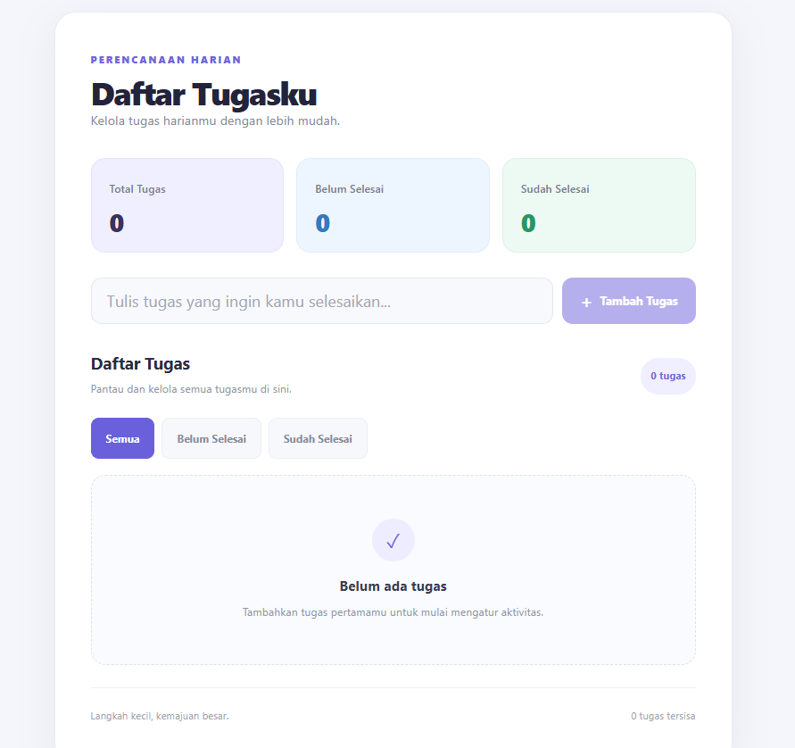

# Todo List App

A simple and responsive Todo List application built with React and Vite. This application helps users manage daily tasks by adding, deleting, completing, and filtering tasks.

## Live Demo

[View Live Demo](https://react-todo-list-ochre-three.vercel.app/)

## Screenshots



## Features

- **Add Tasks** – Create new tasks with a title.
- **Delete Tasks** – Remove tasks from the list.
- **Complete Tasks** – Mark tasks as completed or active.
- **Filter Tasks** – Filter tasks by All, Active, and Completed.
- **Task Counter** – Display the total number of tasks, active tasks, and completed tasks.
- **Local Storage** – Automatically save tasks in the browser so they remain available after refreshing the page.
- **Responsive Design** – Adapt the interface to different screen sizes.

## Tech Stack

- React
- JavaScript
- Vite
- CSS
- Browser Local Storage

## Project Structure

```text
src/
├── components/
│   ├── TodoList.jsx
│   └── TodoList.css
├── App.jsx
├── index.css
└── main.jsx
```

## Getting Started

Follow these steps to run the project locally.

### 1. Clone the repository

```bash
git clone https://github.com/wildann21/react-todo-list.git
```

### 2. Navigate to the project directory

```bash
cd react-todo-list
```

### 3. Install dependencies

```bash
npm install
```

### 4. Run the development server

```bash
npm run dev
```

Open the local URL provided by Vite in your browser.

### 5. Build for production

```bash
npm run build
```

## Data Storage

This application uses the browser's `localStorage` to store task data.

Tasks are saved locally in the user's browser and remain available after refreshing the page. Data is not synchronized across different devices or browsers.

## Learning Objectives

This project was developed as a React learning project to practice:

- React Components and JSX
- React Hooks (`useState` and `useEffect`)
- Event Handling
- Array Methods (`map` and `filter`)
- State Management
- Conditional Rendering
- Browser Local Storage
- Responsive UI Development

## Notes

This application is a frontend project. It does not use a custom backend or server-side database.
